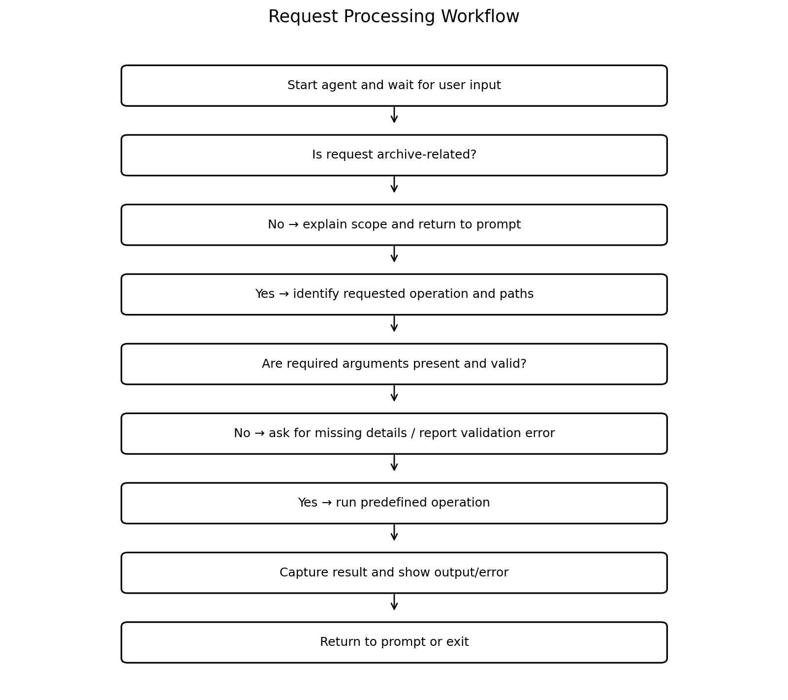

<div align="center">

# Smart Archive Agent
### An Autonomous, Security-Centric Storage & Archiving Agent for Linux
**Operating Systems Project | Agentic Shell Specialist**

---

### **Team 12**
| Student Name | Registration Number | Email |
| :--- | :---: | :--- |
| **Kush Aghera** | `24BCE0149` | redrighthand2007@gmail.com |
| **Sandeep More** | `24BCE2883` | krishmore2006@gmail.com |

[-brightgreen.svg)]()
[]()
[]()
[](LICENSE)

</div>

---

## 📌 Executive Summary

Modern terminal operators face steep syntactical friction when handling disparate archiving, compression, and encryption utilities (`tar`, `gzip`, `bzip2`, `xz`, `zip`, `gpg`). Minor syntax errors—such as argument inversion or unvetted directory extraction—pose critical risks including accidental data loss and path traversal exploits.

**Smart Archive Agent** is an autonomous system specialist designed for Ubuntu Linux. It translates human conversational requests into strictly bounded, verified operating system calls. Built on a deterministic safety-first architecture, the agent eliminates arbitrary shell injection, defends against directory traversal (Zip Slip), and validates file boundaries prior to execution.

---

## 🏗️ System Architecture

The agent operates through a 5-stage closed execution lifecycle:
$$\text{User Request} \longrightarrow \text{Intent Classification} \longrightarrow \text{Security Guardrails} \longrightarrow \text{System Tool Subprocess} \longrightarrow \text{Structured Feedback}$$

<div align="center">
  
  <p><em>Figure 1: High-Level Modular Architecture of the Smart Archive Agent.</em></p>
</div>

### Architectural Modules:
1. **Interface Layer (`app/main.py`)**: Hosts the conversational Read-Eval-Print Loop (REPL) and provides direct single-command CLI execution.
2. **Orchestration Layer (`app/agent.py`)**: Dispatches recognized intents to a registered `TOOL_MAP`, ensuring unhandled errors never crash the interactive terminal.
3. **Intent Parsing Engine (`app/intent.py`)**: Uses deterministic tokenization and regex path extractors to identify actions and paths without requiring third-party cloud API keys.
4. **Security Subsystem (`app/security/validation.py`)**: Enforces path resolution, canonical boundary validation, Zip-Slip prevention, and cryptographic checksum auditing.
5. **Tooling Layer (`app/tools/`)**: Encapsulates native POSIX utilities into modular Python interfaces:
   - `archive.py`: Handles multi-format packaging (`tar`, `tar.gz`, `tar.bz2`, `tar.xz`, `zip`), inspection, and extraction.
   - `encryption.py`: Manages authenticated AES-256 symmetric encryption and decryption backed by GnuPG.

---

## 🔄 Request Processing Workflow

<div align="center">
  
  <p><em>Figure 2: End-to-End Request Validation and Guardrail Workflow.</em></p>
</div>

Every query is filtered through domain classification:
- **Out-of-Scope Requests**: Intercepted at the intent boundary and rejected without executing system commands.
- **Incomplete Requests**: The agent identifies missing parameters (e.g., target output path) and prompts the user for clarification.
- **Valid Requests**: Arguments are vetted by the security validator before invoking low-level POSIX binaries.

---

## 🛡️ Security & Defensive Guardrails

| Defensive Guardrail | Implementation Mechanism | Threat Mitigated |
| :--- | :--- | :--- |
| **No Shell Injection** | `subprocess.run(args, shell=False)` | Eliminates command injection by passing structured argument vectors instead of evaluated shell strings. |
| **Zip Slip Defense** | Canonical path resolution (`target.parents`) | Rejects archive members containing relative `../` or root paths attempting directory traversal. |
| **Accidental Overwrite Guard** | `resolve_output_path()` existence check | Prevents unintentional loss of existing files by halting if the output file already exists. |
| **Inode Collision Check** | `reject_same_path(src, dest)` | Verifies source and destination paths resolve to different inodes, preventing file truncation. |
| **Least Privilege** | Unprivileged execution (no `sudo`) | Operates entirely under standard user permissions, protecting root filesystem boundaries. |

---

## 💻 Installation & Environment Setup

### 1. Prerequisites (Ubuntu Linux / WSL 2)
```bash
sudo apt update
sudo apt install -y python3 python3-venv tar gzip bzip2 xz-utils gnupg file unzip zip python-is-python3
```

### 2. Clone & Environment Setup
```bash
git clone https://github.com/redrighthand2007/OS-SMART-ARCHIVE-AGENT.git
cd OS-SMART-ARCHIVE-AGENT
python -m venv .venv
source .venv/bin/activate
pip install -r requirements.txt
```

---

## 🚀 Demonstration & Usage

### 1. Interactive REPL Mode
Start the interactive agent prompt:
```bash
python app/main.py
```

```text
Smart Archive Agent (Ubuntu)
Archive, compress, extract, inspect, encrypt, and decrypt files.
Type 'exit' to quit. This initial version uses a local intent router.

You: Create an archive of ./app ./app.tar.xz
Agent:
Archive created using xz compression.
Output: /home/adminredrighthand2007/SMART-ARCHIVE-AGENT/app.tar.xz

You: inspect archive ./app.tar.xz
Agent:
Archive/file type: XZ compressed data
 - app/main.py
 - app/agent.py
 - app/intent.py
 - app/security/validation.py
 - app/tools/archive.py
 - app/tools/encryption.py

You: Delete everything on my drive
Agent:
That request is outside the Smart Archive Agent's scope.

You: exit
Goodbye.
```

### 2. Direct Command-Line Mode
Execute single commands directly from the terminal:
```bash
# Archive a folder
python app/main.py "Create an archive of ./app ./app.tar.xz"

# Inspect archive contents
python app/main.py "inspect archive ./app.tar.xz"

# Extract archive
python app/main.py "Extract ./app.tar.xz into ./restored"

# Encrypt with AES-256 GPG
python app/main.py "Encrypt ./app.tar.xz ./app.tar.xz.gpg"
```

---

## 🧪 Automated Testing & Verification

The project includes an automated Pytest test suite covering validation rules, multi-format archive creation, extraction safety, stream compression, and intent classification:

```bash
pytest -v
```

### Test Suite Execution Output:
```text
============================= test session starts ==============================
platform linux -- Python 3.14.4, pytest-9.1.1, pluggy-1.7.0
rootdir: /home/adminredrighthand2007/SMART-ARCHIVE-AGENT
configfile: pytest.ini
collected 14 items

tests/test_end_to_end.py::test_validation_rules PASSED                   [  7%]
tests/test_end_to_end.py::test_archive_creation_listing_extraction PASSED [ 14%]
tests/test_end_to_end.py::test_compress_and_decompress_file PASSED       [ 21%]
tests/test_end_to_end.py::test_agent_handle_request_pipeline PASSED      [ 28%]
tests/test_end_to_end.py::test_calculate_checksum PASSED                 [ 35%]
tests/test_end_to_end.py::test_output_already_exists_rejection PASSED    [ 42%]
tests/test_end_to_end.py::test_missing_argument_prompt PASSED            [ 50%]
tests/test_intent.py::test_unrelated_request_is_rejected PASSED          [ 57%]
tests/test_intent.py::test_archive_request_is_recognized PASSED          [ 64%]
tests/test_intent.py::test_extract_request_is_recognized PASSED          [ 71%]
tests/test_intent.py::test_empty_request PASSED                          [ 78%]
tests/test_intent.py::test_archive_paths_are_not_confused_with_instruction_words PASSED [ 85%]
tests/test_intent.py::test_extract_paths_are_mapped_correctly PASSED     [ 92%]
tests/test_intent.py::test_encrypt_paths_are_mapped_correctly PASSED     [100%]

============================== 14 passed in 0.07s ==============================
```

---

## 📑 Formal Review Reports

Complete course review documentation is compiled and available in both Microsoft Word (`.docx`) and Adobe PDF (`.pdf`) formats inside [`docs/`](docs/):

| Report Document | Chapters & Sections Covered | Download Links |
| :--- | :--- | :---: |
| **Review 1 Report** | Introduction, Problem Statement, Objectives, Scope & Limitations, Literature Review, MCP Overview, Comparison Table. | [DOCX](docs/Review_1_Smart_Archive_Agent.docx) \| [PDF](docs/Review_1_Smart_Archive_Agent.pdf) |
| **Review 2 Report** | System Architecture, 5-Stage Lifecycle, Fig 1, Component Design, Tool Mapping Table, Security Framework, Fig 2. | [DOCX](docs/Review_2_Smart_Archive_Agent.docx) \| [PDF](docs/Review_2_Smart_Archive_Agent.pdf) |
| **Review 3 Report** | Test Cases & Scenarios, Performance Benchmarks, Conclusion, Challenges Encountered, Future Scope, Screenshots Walkthrough. | [DOCX](docs/Review_3_Smart_Archive_Agent.docx) \| [PDF](docs/Review_3_Smart_Archive_Agent.pdf) |

---

## 📜 License

This project is licensed under the MIT License — see the [LICENSE](LICENSE) file for details.
