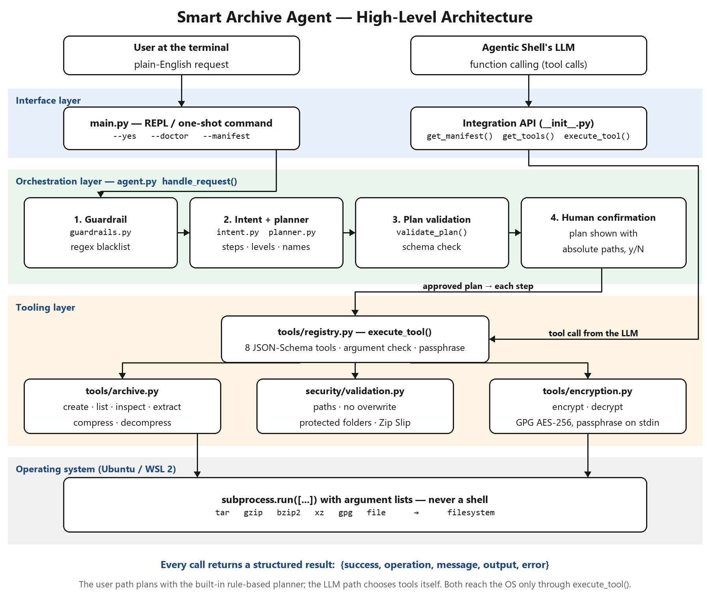

<div align="center">

# Smart Archive Agent
### Agent #12 of the Agentic Shell — archive, compress and encrypt files in plain English on Linux
**Operating Systems Project | Agentic Shell**

---

### **Team 12**
| Student Name | Registration Number | Email |
| :--- | :---: | :--- |
| **Kush Aghera** | `24BCE0149` | redrighthand2007@gmail.com |
| **Sandeep More** | `24BCE2883` | krishmore2006@gmail.com |

[]()
[]()
[]()
[](LICENSE)

</div>

---

## What it does

You type a request such as:

```text
Zip up my project folder, compress it heavily, and encrypt it.
```

and the agent plans and runs the Linux operations for you:

```text
Plan:
  1. Archive /home/user/project -> /home/user/project.tar.xz  (bundle into one xz archive (max compression))
  2. Encrypt /home/user/project.tar.xz -> /home/user/project.tar.xz.gpg  (encrypt with GPG AES-256)
  3. Delete temporary file /home/user/project.tar.xz  (delete the unencrypted copy so only the .gpg file remains)
Proceed? [y/N]: y
Passphrase:
Repeat passphrase:
```

It covers the capabilities in the Agent #12 brief: **tar, gzip, bzip2, xz, zip and gpg**, chained together from words such as *heavily*, *quickly* and *encrypt*.

| Capability | Tool | Linux backend |
| :--- | :--- | :--- |
| Archive a file or folder | `create_archive` | `tar` with `gzip` / `bzip2` / `xz`, or Python `zipfile` |
| Compress one file | `compress_file` | `gzip`, `bzip2`, `xz` |
| List / inspect an archive | `list_archive`, `inspect_archive` | `tar -tf`, `file`, `zipfile` |
| Extract safely | `extract_archive` | Python `tarfile` / `zipfile` with Zip Slip checks |
| Decompress one file | `decompress_file` | `gzip -d`, `bzip2 -d`, `xz -d` |
| Encrypt / decrypt | `encrypt_file`, `decrypt_file` | `gpg --symmetric --cipher-algo AES256` |

Compression levels: **fast** (gzip -1, xz -1), **normal** (gzip -6, xz -6), **max** (gzip -9, bzip2 -9, `xz -9e`).

---

## For the Course Instructor: Set Up and Integrate (Step by Step)

Everything below runs on any Ubuntu or Debian PC (or WSL). Open a normal **terminal** for every step.
The agent needs Python 3.8+, no extra Python packages, and no root access (only `apt` needs `sudo`).
A longer reference with every option is in **[INTEGRATION.md](INTEGRATION.md)**.

### Part A: Install the agent and check it

**Step 1: Install the Linux tools.** Once per machine.
*Where:* any terminal, any folder.

```bash
sudo apt install -y python3 python3-venv python3-pip git tar gzip bzip2 xz-utils gnupg file
```

**Step 2: Open the Agentic Shell's folder and switch on its virtual environment.**
*Where:* the base shell's own project folder (replace `~/agentic-shell` with its real path).

```bash
cd ~/agentic-shell
python3 -m venv .venv          # only the first time, if the shell has no .venv yet
source .venv/bin/activate      # in every new terminal; the prompt then starts with (.venv)
```

> On Ubuntu 23.04 and newer, `pip install` outside a virtual environment fails with
> `error: externally-managed-environment`, so this step is required.

**Step 3: Install this agent from GitHub.**
*Where:* the same terminal, with `(.venv)` showing.

```bash
pip install git+https://github.com/redrighthand2007/OS-SMART-ARCHIVE-AGENT.git
```

**Step 4: Check the installation.**
*Where:* the same terminal, any folder.

```bash
smart-archive-agent --doctor       # every line should say [ok]
smart-archive-agent --version      # prints 1.0.0
```

If a line says `[MISSING]`, run the `sudo apt install ...` command it prints, then check again.

**Step 5: Try one real request.**
*Where:* the same terminal. These commands create a small test folder in your home directory.

```bash
mkdir -p ~/archive-test/demo && echo "hello" > ~/archive-test/demo/a.txt
cd ~/archive-test
smart-archive-agent --yes "back up ./demo quickly"     # creates ~/archive-test/demo.tar.gz
smart-archive-agent                                    # interactive mode; type 'exit' to quit
```

### Part B: Connect the agent to the Agentic Shell

**Step 6: Import the agent in the shell's code.**
*Where:* the base shell's Python source file that loads agents. Run the shell with the same `.venv` active.

```python
import smart_archive_agent as archive_agent

manifest = archive_agent.get_manifest()   # agent #12: description, routing keywords, requirements
```

The manifest (also saved as [agent.json](agent.json)) tells the shell's router what this agent handles,
and also what it does **not** handle (file search, deleting or shredding files, log rotation), so requests
for those go to the right agent.

**Step 7: Give the agent's tools to the shell's LLM.**
*Where:* the code that builds the tool list for the LLM request.

```python
tools = archive_agent.get_tools("openai", prefixed=True)   # "openai" also suits Ollama; "anthropic" for Claude
# add the other agents' tools to the same list, then send it with the LLM request
```

`prefixed=True` names the tools `smart_archive__create_archive` and so on, so they cannot clash with
other agents' tool names.

**Step 8: Run the tool the LLM chooses.**
*Where:* the code that handles the LLM's tool calls.

```python
import json

for call in response.choices[0].message.tool_calls or []:
    if call.function.name.startswith(archive_agent.TOOL_PREFIX):
        result = archive_agent.execute_tool(call.function.name,
                                            call.function.arguments,   # JSON string, passed as is
                                            passphrase=secret)         # only for encrypt/decrypt
        messages.append({"role": "tool", "tool_call_id": call.id, "content": json.dumps(result)})
```

* Every call returns a dictionary such as `{"success": True, "message": "...", "output": "/path/file.tar.xz"}`,
  or `{"success": False, "error": "..."}`. `execute_tool` never raises.
* Unknown tools and wrong or missing arguments are rejected **before** anything runs.
* The passphrase for `encrypt_file` / `decrypt_file` must come from the user, never from the LLM. If it is
  not passed and a terminal is attached, the agent asks for it with hidden input.

**Step 9 (optional): Hand over a whole sentence without an LLM.**
*Where:* anywhere in the shell's code, for example as a fallback when the LLM is unavailable.

```python
result = archive_agent.handle_request("Zip up my project folder, compress it heavily, and encrypt it.",
                                      confirm=lambda plan: True,   # or show the plan and ask the user
                                      passphrase=secret)
```

The eight tools are `create_archive`, `extract_archive`, `list_archive`, `inspect_archive`, `compress_file`,
`decompress_file`, `encrypt_file` and `decrypt_file`; their arguments are listed in
[INTEGRATION.md](INTEGRATION.md#3-tools).

### Part C (optional): Run the tests and the integration example

*Where:* any folder, with a virtual environment active. The tests and examples are in the repository,
not in the pip package, so clone it first.

```bash
git clone https://github.com/redrighthand2007/OS-SMART-ARCHIVE-AGENT.git ~/OS-SMART-ARCHIVE-AGENT
cd ~/OS-SMART-ARCHIVE-AGENT
pip install pytest
python3 -m pytest -q                         # expected: 58 passed
python3 examples/agentic_shell_example.py    # a tiny pretend shell: loads the agent, routes, runs tool calls
```

**Updating later:** `pip install --upgrade git+https://github.com/redrighthand2007/OS-SMART-ARCHIVE-AGENT.git`

---

## Use (for anyone)

From a clone of this repository (or use `smart-archive-agent` in place of `python3 -m smart_archive_agent`
after `pip install`):

```bash
python3 -m smart_archive_agent                                   # interactive shell
python3 -m smart_archive_agent "create a zip file of ./src"      # one request (asks before writing)
python3 -m smart_archive_agent --yes "back up ./src quickly"     # one request, no confirmation prompt
python3 -m smart_archive_agent --doctor                          # dependency check
python3 -m smart_archive_agent --manifest                        # agent description as JSON
```

Example requests:

```text
Zip up my project folder, compress it heavily, and encrypt it.
archive ./src with maximum compression
compress ./data.csv quickly
create a zip file of ./photos
inspect archive ./project.tar.xz
what is inside ./photos.zip
extract ./project.tar.xz into ./restored
decrypt ./project.tar.xz.gpg and extract it
```

If no output name is given, the agent chooses one next to the source (`project.tar.xz`, `project.tar.xz.gpg`) and never overwrites an existing file (`project-1.tar.xz`, ...).

---

## Architecture

```text
User text ─▶ Guardrail ─▶ Planner ─▶ Plan validation ─▶ Confirmation ─▶ Tool execution ─▶ Result
            (regex       (intent +    (schemas,          (human in       (tar, xz, gpg …
             blacklist)   chaining)    clean-up rules)    the loop)       via subprocess)
```

| Module | Role |
| :--- | :--- |
| `smart_archive_agent/main.py` | Command line, interactive shell, `--doctor`, `--manifest` |
| `smart_archive_agent/manifest.py` | Agent description for the shell's router (`agent.json`) |
| `smart_archive_agent/agent.py` | `handle_request()`: guardrail → plan → validate → confirm → run |
| `smart_archive_agent/intent.py` | Deterministic intent recognition (whole-word vocabulary, path extraction) |
| `smart_archive_agent/planner.py` | Builds multi-step plans, compression levels, default names, safe clean-up |
| `smart_archive_agent/tools/registry.py` | Tool schemas for LLM function calling, `execute_tool()` |
| `smart_archive_agent/tools/archive.py` | tar / zip / gzip / bzip2 / xz operations |
| `smart_archive_agent/tools/encryption.py` | GPG AES-256 encryption and decryption |
| `smart_archive_agent/security/guardrails.py` | Destructive-command blacklist, protected system folders |
| `smart_archive_agent/security/validation.py` | Path resolution, overwrite and same-path checks |

<div align="center">
  
</div>

---

## Safety

| Guardrail | How |
| :--- | :--- |
| No shell injection | `subprocess.run([...])` with argument lists, never `shell=True` |
| Destructive requests blocked | Regex blacklist: `rm -rf`, `mkfs`, `dd if=`, fork bombs, `shutdown`, `$(...)`, `; rm`, whole-root `/` |
| Human in the loop | Every plan that writes files is shown with absolute paths and needs `y` |
| Protected locations | Never writes into `/etc`, `/usr`, `/bin`, `/sbin`, `/boot`, `/dev`, `/lib`, `/proc`, `/sys`, `/var/lib` |
| Zip Slip | Every archive member is checked before the destination folder is even created; links are refused |
| No overwrites | Existing outputs are never replaced; source and output must differ |
| Passphrases | Read with hidden input, sent to `gpg` on stdin (loopback pinentry), never in arguments, logs or files |
| Plaintext clean-up | After encrypting an archive the agent created, the unencrypted copy is deleted; only files created in the same request can be deleted |
| Model output checked | Tool calls from an LLM are validated against the JSON schemas before running |

---

## Tests and measurements

```bash
python3 -m pytest -q                 # 58 tests
python3 benchmarks/evaluate.py       # metrics used in the Review 3 report
```

Latest benchmark (Ubuntu 26.04.1 on WSL 2, Python 3.14, GNU tar 1.35, xz 5.8.3, GnuPG 2.4.8):

| Metric | Result |
| :--- | :--- |
| Intent accuracy, held-out phrasings (never tuned on) | **16/20 = 80%** |
| Intent accuracy, development phrasings | 65/65 = 100% |
| Planning time per request | < 0.2 ms |
| Brief's example end to end (1.25 MB, xz -9e + GPG + clean-up) | ≈ 0.3 s |
| Invalid / unsafe tool calls handled without crash or side effects | **18/18 = 100%** |

Full numbers are in [`benchmarks/results.json`](benchmarks/results.json).

---

## Review reports

All three reviews are in one document, in the order Review 1 → Review 2 → Review 3:
[PDF](docs/Team12_Smart_Archive_Agent_Reviews_1-3.pdf) | [DOCX](docs/Team12_Smart_Archive_Agent_Reviews_1-3.docx)

| Review | Contents |
| :--- | :--- |
| Review 1 | Introduction, literature review |
| Review 2 | Architecture and design, implementation methodology |
| Review 3 | Testing and results, conclusion and future scope, screenshots |

---

## License

MIT — see [LICENSE](LICENSE).
