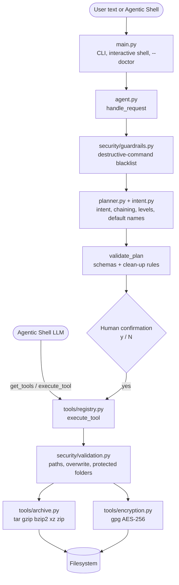

# Smart Archive Agent — Architecture

## Request lifecycle

1. **Guardrail** — `check_request()` matches the raw text against a regex blacklist (`rm -rf`, `mkfs`, `dd if=`, fork bomb, `shutdown`, `$(...)`, `; rm`, a bare `/`). A match stops the request before any planning.
2. **Intent** — `classify()` removes file paths from the text, then matches whole-word verb vocabularies in a fixed priority order: decrypt, encrypt, extract, decompress, list, compress, archive. Paths are extracted with `PATH_RE`.
3. **Planning** — `plan_local()` turns the intent into ordered `Step`s:
   * folders are always archived before compression or encryption;
   * *heavily / maximum / as small as possible* → level `max`; *quick / fast* → `fast`;
   * *zip file* → zip format, *gzip / bzip2 / xz* → that algorithm, otherwise the output extension decides;
   * missing output names are chosen next to the source and made unique;
   * after encrypting an archive the agent named itself, a `remove_intermediate` step deletes the plaintext copy.
4. **Validation** — `validate_plan()` checks every step against the JSON schemas in `tools/registry.py`, and allows `remove_intermediate` only for files produced earlier in the same plan.
5. **Confirmation** — any plan that writes is shown with absolute paths; nothing runs without `y`.
6. **Execution** — `execute_tool()` re-validates arguments, collects the passphrase if needed, and calls the tool. Tools resolve paths, refuse protected locations and existing outputs, and run Linux utilities through `subprocess.run` with argument lists.
7. **Result** — a dictionary with `success`, `message`, `output`, and `error`; a failed step stops the plan and reports which steps finished.

## Integration with the Agentic Shell

The base shell owns the LLM. It reads `get_tools()` (plain JSON Schema, or OpenAI / Anthropic wrapping), lets its model pick a tool, and calls `execute_tool(name, args, passphrase=...)`. The model can only choose among the eight tools and their schema-checked arguments; it never builds a shell command. `handle_request()` is the offline path that needs no LLM.

## Why the planner is rule-based

The agent must work on any lab machine without an API key or network, and its behaviour must be predictable for safety review. The LLM path is provided by the shell through the tool schemas. The benchmark shows the trade-off: the rule-based planner reaches 80% on unseen phrasings, which is why the LLM front end matters for open-ended wording.
